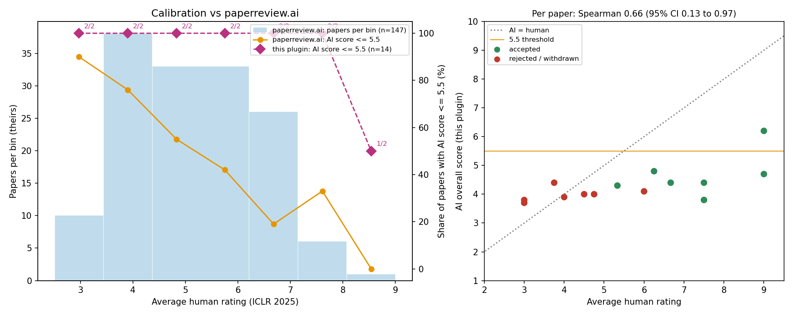
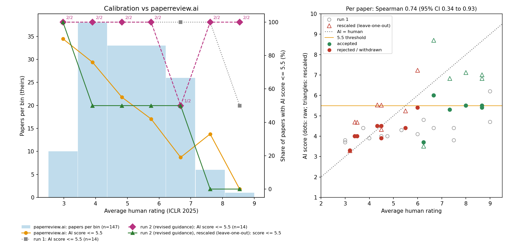

# Calibration report

How this plugin's scores line up with human ICLR 2025 reviews, measured the
way paperreview.ai describes its own calibration
(https://paperreview.ai/tech-overview).

## What paperreview.ai published

- 300 random ICLR 2025 submissions; the 3 withdrawn papers with no human
  scores were dropped. A regression was fitted on 150 papers and tested on
  the remaining 147.
- Spearman correlation with one human reviewer: 0.42 for the AI, against
  0.41 between two humans.
- AUC for predicting acceptance: 0.75 for the AI, 0.84 for one human.
- A calibration plot over 7 bins of average human rating. Read off the
  image, the share of papers given an AI score of 5.5 or less in each bin
  was: about 90% (~3.0), 76% (~3.9), 55% (~4.8), 42% (~5.8), 19% (~6.7),
  33% (~7.6) and 0% (~8.5). The bins held 10, 38, 33, 33, 26, 6 and 1
  papers.

## Method

1. **Sample.** `sample_iclr2025.py` draws 2 papers at random from each of
   the 7 bins, using the same bin edges as their plot (2.5 to 9.0). It
   draws from every ICLR 2025 main-track submission with at least one
   rating, including withdrawn ones, as theirs did; desk rejects are left
   out. Ratings come from the public Paper Copilot list and are checked
   against the official OpenReview reviews.
2. **Blinding.**
   - Each PDF is the earliest revision on OpenReview whose page 1 reads
     "Under review as a conference paper at ICLR 2025". The camera-ready
     header would reveal acceptance.
   - Files are renamed `paper_NN.pdf`.
   - Reviewers never see the score, the decision or the paper ID, and may
     not use web search or OpenReview.
3. **Review.** One Claude subagent per paper runs the plugin's `paper-review`
   skill with venue ICLR and a literature cutoff of 2024-10-01, the ICLR
   2025 submission deadline. Only arXiv papers submitted by that date count
   as prior work, and with a cutoff each paper is downloaded as its first
   version.
4. **Validity gate.** `analyze.py` refuses any run that retrieved no related
   literature. The first attempt at run 1 lost 8 reviews this way: arXiv
   rate-limited the machine and the reviewers wrote reviews without
   literature. Those runs were discarded and redone after the search script
   gained a machine-wide rate limiter. In the final runs, every review used
   8 to 12 related papers and read 3 to 5 in full. In these runs the
   related papers were summarized by the reviewer itself, one after
   another, not by parallel summarizer subagents.
5. **Analysis.** `analyze.py` computes the per-bin share of AI scores ≤ 5.5
   next to paperreview.ai's values, the Spearman correlation with a
   bootstrap 95% interval, the mean AI minus human gap, and the AUC for
   accepted (Poster, Spotlight, Oral) vs. not.

## Run 1: original scoring guidance

Data: [`run1/results.csv`](run1/results.csv) · plot:
[`run1/plot.png`](run1/plot.png)

| Bin (avg human rating) | paperreview.ai: AI ≤ 5.5 | This plugin |
|---|---|---|
| ~3.0 | 90% | 2/2 |
| ~3.9 | 76% | 2/2 |
| ~4.8 | 55% | 2/2 |
| ~5.8 | 42% | 2/2 |
| ~6.7 | 19% | 2/2 |
| ~7.6 | 33% | 2/2 |
| ~8.5 | 0% | 1/2 |

| Metric | paperreview.ai (n=147) | This plugin, run 1 (n=14) |
|---|---|---|
| Spearman with human average | 0.42 (with one human) | 0.66 (95% CI 0.13 to 0.97) |
| AUC, accepted vs. not | 0.75 | 0.85 |
| Mean AI − human | not reported | −1.41 |
| Mean absolute error | not reported | 1.72 |

**Reading.**
- **Ranking:** the plugin ordered papers well. It separated accepted papers
  from rejected and withdrawn ones better than chance, and at least as well
  as paperreview.ai reports for itself. With 14 papers the interval is
  wide, so this is consistent with theirs, not shown to be better.
- **Scale:** the scores were compressed and too low. They ranged 3.7 to 6.2
  (standard deviation 0.64), against human averages of 3.0 to 9.0 (1.96),
  and 13 of 14 papers scored 5.5 or less. A Spotlight paper with a human
  average of 7.5 scored 3.8, and two Orals with 9.0 scored 6.2 and 4.7. On
  this sample the plugin's effective accept line sat near 4.5, not 6.
- **Why:** the dimension scores point to the scoring guidance. Accepted
  papers, Orals included, got 3–4 on claims-supported and soundness (means
  3.64 and 3.71). The guidance said that most papers land at 4–6, that a
  score above 6 needs a special reason, and that a score of 7 or more must
  be re-verified. Those rules answered GPT-4-era reviewers that inflated
  scores; with Claude they over-correct. Of the 7 dimensions,
  contextualization tracked the human average most closely (Spearman 0.78)
  and importance least (0.30).
- **Fix:** the guidance was changed (`skills/paper-review/references/scoring.md`):
  - It no longer pushes scores toward 4–6 and no longer sets an extra
    hurdle above 6.
  - It asks whether each weakness breaks the main claim or is a gap a
    revision can fill, and to check for under-scoring as well as
    over-scoring.
  - It states that a paper whose claims hold up with adequate experiments
    scores 6 or more on those dimensions.
  - The anchors, weights and grounding rules are unchanged.

## Run 2: revised guidance, 14 fresh papers

A fresh draw of 14 papers, 2 per bin, none of them from run 1, reviewed
under the revised guidance with the same blinding.

Data: [`run2/results.csv`](run2/results.csv) · plot:
[`run2/plot.png`](run2/plot.png). In the plot, run 1 is grey, the raw run 2
scores are pink, and run 2 after the rescale is green.

| Bin (avg human rating) | paperreview.ai: AI ≤ 5.5 | Run 2, raw | Run 2, rescaled (leave-one-out) |
|---|---|---|---|
| ~3.0 | 90% | 2/2 | 2/2 |
| ~3.9 | 76% | 2/2 | 1/2 |
| ~4.8 | 55% | 2/2 | 1/2 |
| ~5.8 | 42% | 2/2 | 1/2 |
| ~6.7 | 19% | 1/2 | 1/2 |
| ~7.6 | 33% | 2/2 | 0/2 |
| ~8.5 | 0% | 2/2 | 0/2 |

| Metric | paperreview.ai (n=147) | Run 1 (n=14) | Run 2 raw (n=14) | Run 2 rescaled, leave-one-out |
|---|---|---|---|---|
| Spearman with human average | 0.42 (with one human) | 0.66 (CI 0.13–0.97) | 0.74 (CI 0.34–0.93) | 0.74 (a rescale keeps rank order) |
| AUC, accepted vs. not | 0.75 | 0.85 | 0.82 | 0.82 (same reason) |
| Mean AI − human | not reported | −1.41 | −1.08 | 0.00 |
| Mean absolute error | not reported | 1.72 | 1.28 | 1.15 |
| Share scored ≤ 5.5 | about half | 13/14 | 13/14 | 6/14 |

**Reading.**
- **Ranking held up on new papers.** Spearman was 0.74 and AUC 0.82, close
  to run 1. Both runs rank papers at least as well as paperreview.ai
  reports for itself. With 14 papers per run the intervals are wide, so
  this means "comparable", not "better".
- **The softer guidance helped only a little.** The mean gap went from −1.41
  to −1.08. The three Orals scored 5.4–5.5, up from 4.7–6.2 in run 1. No
  paper scored above 6.0, and 13 of 14 still scored 5.5 or less. On the raw
  scale the plugin's effective accept line sits near 5.3, not 6.
- **So a rescale was added.** It is fitted on the 14 run 2 papers, matching
  the guidance that ships, the way paperreview.ai maps its dimensions onto
  the human scale with a fitted regression:
  `overall = clamp(−2.71 + 1.81 × raw, 1, 10)`.
  - Its error was measured by leaving one paper out at a time: each paper
    is predicted by a fit on the other 13.
  - The coefficients stayed in a narrow range across those fits: intercept
    −4.28 to −2.12, slope 1.66 to 2.11.
  - The rescale removed the bias (−1.08 → 0.00) and cut the mean error from
    1.28 to 1.15.
  - The calibration curve now falls the way theirs does: half or fewer of
    the papers in the middle bins score ≤ 5.5, and none above a human
    average of 7.
  - A straight-line rescale cannot change Spearman or AUC, because both
    depend only on the order.
- **A cross-check on unseen papers.** A rescale fitted on run 1 (old
  guidance) and applied unchanged to the run 2 papers cut the mean error
  from 1.28 to 1.13, with a bias of +0.71. It overshoots because run 1's
  guidance scored lower. That fit was made under different guidance, so it
  is a sanity check, not a test of the shipped coefficients.
- **Biggest miss.** paper_10, a Poster with a human average of 6.25, scored
  raw 3.7, which rescales to 3.5. The reviewer graded its claims and
  soundness 3. This is the kind of single-paper disagreement the ±1.5
  caveat is about.
- **Not done.** The shipped coefficients were not tested on a third,
  fresh set of papers. Run `--rescale=-2.71,1.81` on a new draw to do that.

**How run 2 was recorded.**
- The session's temp folder, which held the run 2 PDFs and review files,
  was cleared while the last two reviews (paper_03, paper_06) were still
  running.
- The scores of the other 12 were rebuilt from each reviewer's final report.
  Each report gave the 7 dimension scores and the overall, and every
  overall matches its weighted sum. Their review texts were lost.
- Their score files carry a `note` field saying so, plus a `related_count`
  taken from the report.
- Three reports (paper_02, paper_04, paper_13) named no arXiv IDs, so those
  papers pass the no-literature check on the reported count (8, 12 and 11
  related papers) rather than on listed IDs.
- paper_03 and paper_06 were downloaded again from OpenReview and reviewed
  again from scratch with the same instructions. Their full score files are
  kept.
- In run 2, every review used 8 to 12 related papers.

## Caveats

- **Sample size.** 14 papers per run, against paperreview.ai's 147. Bin
  shares of 0/2, 1/2 or 2/2 are coarse, and the Spearman interval is wide.
- **Possible contamination.** ICLR 2025 papers and their public reviews
  predate the model's training data. The reviewers were told not to use
  any memory of a paper's reception, but that cannot be verified. In run 1
  the only paper scored above 5.5 was the most widely known one in the
  sample (BigCodeBench).
- **PDF version.** OpenReview does not expose the originally submitted file.
  The earliest available "Under review" revision can include changes made
  during the rebuttal, after reviewers scored the paper. The revision used
  for each paper is listed in `manifest.csv`. For run 2 it was lost with
  the temp folder for 12 of 14 papers; the same sampler code chose the
  earliest revision for every paper.
- **A small fit, not their regression.** paperreview.ai maps the 7
  dimensions to a score with a regression fitted on 150 papers. This plugin
  uses fixed default weights, then a two-number rescale fitted on 14
  papers. A full 7-weight regression on 14 papers would overfit, so none was
  fitted. The guide explains how to fit one with 100 or more papers. The
  rescale belongs to the current scoring guidance; re-fit it after changing
  the guidance.
- **One model, one prompt.** Different Claude versions or venues may
  behave differently. Re-run `calibration/` after material changes to the
  skill.
